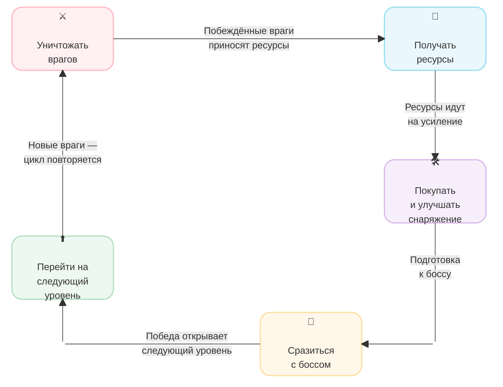

# **Game Overview:**

**Working Title:** Furward

**Genre:** Clicker и RPG

**Platform:** PC (Windows, Linux, macOS)

**Target Audience:** игроки 14–30 лет, любящие гипер-казуальные игры с прогрессией и приятной визуальной подачей

---

# **High Concept:**

**Короткая суть:** через 15 лет после катастрофы шиншилла-разведчик зачищает окраины уцелевшего города и продвигается на север. Зачистка территорий помогают расширять безопасное пространство для своего народа.

---

# **Core Gameplay:**

**Основной цикл игры:**

---

# **Core Experience:**

**Ощущения игрока:**

- дофаминовый отклик от казуального геймплея (простой бой, награды, усиление персонажа)
- понятный игровой цикл с комфортным темпом
- эмоциональный отклик от управления милой шиншиллой в суровом мире

---

# **Key Features:**

**Главные особенности игры:**

- гибридная боевая система (атаки с помощью кликов и применение навыков для автоматизации/усиления кликов)
- снаряжение даёт характеристики и доступ к навыкам
- процедурная вариативность мобов, уровней и боссов
- социально-экологический подтекст: защита шиншилл и их среды обитания (привлечение внимания к защите редких животных)

---

# **Player:**

**Аудитория:** любители гипер-казуальных игр, ориентированные на линейный гринд

---

# **Unique Selling Proposition:**

**Почему наша игра:** милые вооружённые шиншиллы в серьёзном постапокалиптическом мире. Приятный визуал: стилизованное 3D low/mid-poly с hand-painted подачей. Понятный геймплей: простой цикл вылазок ради восстановления дома.

---

# **References:**

- `Archero`: система прогрессии (снаряжение и комнаты)
- `Tap Titans`: основа боевой системы (кликер + активные скиллы)
- `Marmok's Team Monster Crush`: нарративный дизайн (постапокалипсис глазами абсурдных персонажей)

---
